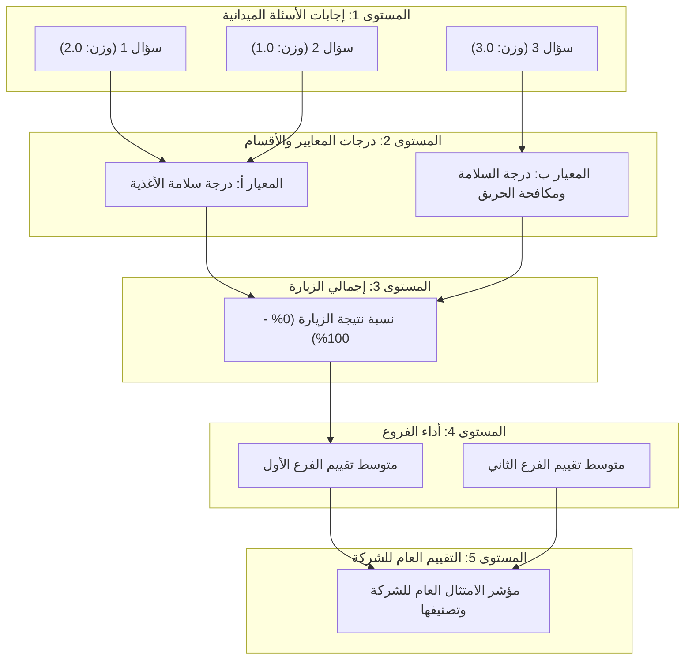
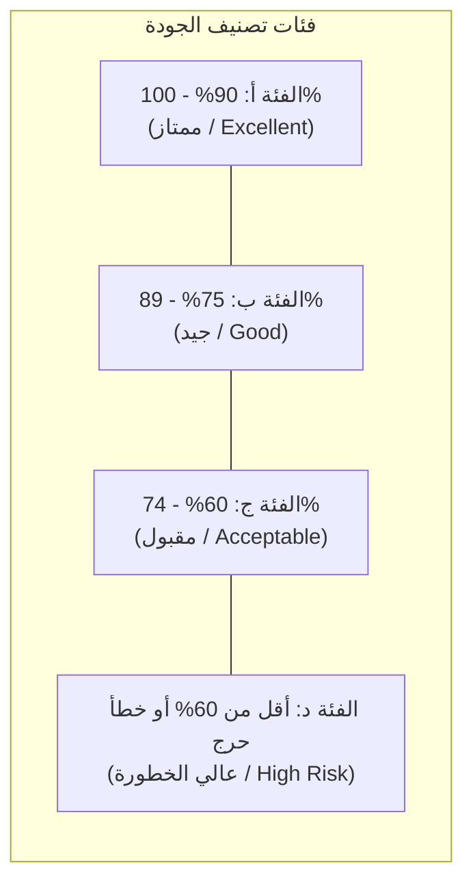
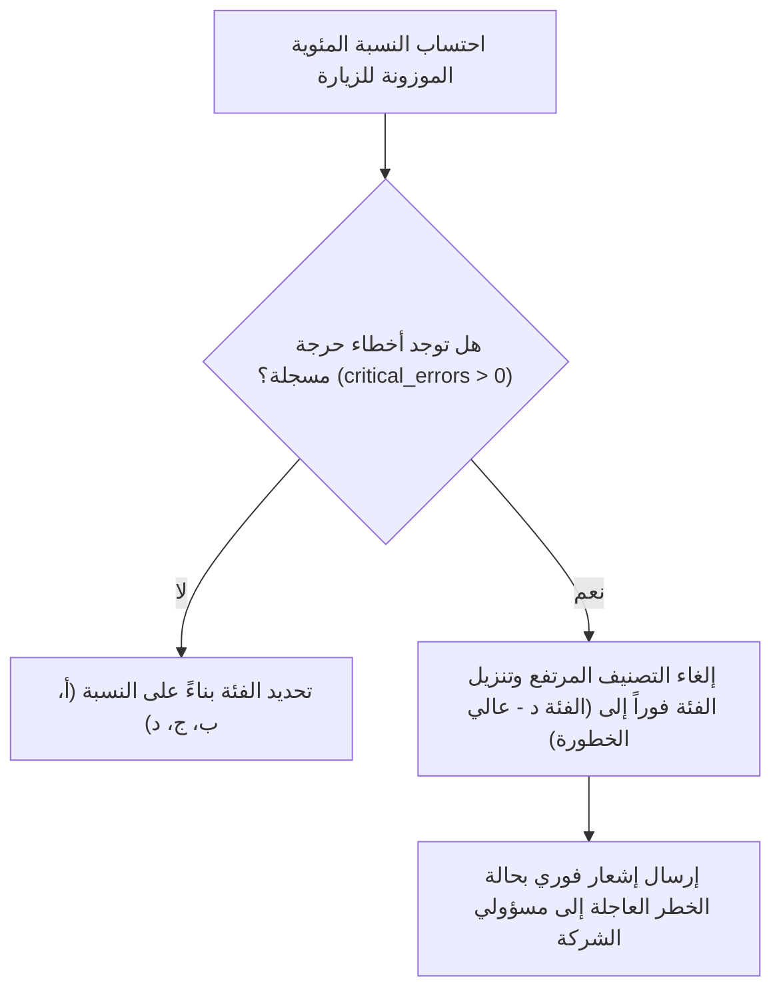

# تصنيف وتقييم الشركات

يحول نظام التقييم في استقرار مئات الملاحظات الميدانية إلى مؤشرات أداء وتصنيفات تنفيذية معتمدة لقياس مستوى جودة المنشآت.

---

## 1. التسلسل الهرمي لاحتساب الدرجات

تتجمع نتائج التفتيش تصاعدياً من الأسئلة الفردية وصولاً إلى التقييم الشامل للشركة:



---

## 2. المعادلات الرياضية للاحتساب

### نسبة درجة المعيار
```
نسبة المعيار % = [مجموع (درجة السؤال × وزن السؤال) ÷ مجموع (الدرجة العظمى × وزن السؤال)] × 100
```

### نسبة تقييم الزيارة الميدانية
```
نسبة الزيارة % = (مجموع النقاط المحققة لكافة المعايير ÷ مجموع النقاط القصوى الممكنة) × 100
```

### المؤشر العام لتقييم الشركة
يقيس متوسط درجات كافة الفروع التابعة للشركة خلال فترة القياس:
```
درجة الشركة = (مجموع درجات كافة الفروع) ÷ (عدد الفروع المفحوصة M)
```

---

## 3. مستويات وتصنيفات الامتثال



| الفئة | النطاق المئوي | لون الشارة | الإجراء المطلوب |
| :--- | :--- | :--- | :--- |
| **الفئة أ (ممتاز)** | 90% – 100% | أخضر (`#16a34a`) | التزام نموذجي. استمرار دورة التدقيق الربع سنوية المعتادة. |
| **الفئة ب (جيد)** | 75% – 89.9% | أزرق (`#2563eb`) | ملاحظات طفيفة. إغلاق تذاكر المعالجة خلال 14 يوماً. |
| **الفئة ج (مقبول)** | 60% – 74.9% | كهرماني (`#d97706`) | مخاطر امتثال متوسطة. فرض زيارة تدقيق تتبعية خلال 30 يوماً. |
| **الفئة د (عالي الخطورة)** | أقل من 60% أو وجود خطأ حرج | أحمر (`#dc2626`) | تصعيد عاجل لإدارة المنشأة؛ إعادة تفتيش إلزامية خلال 48 ساعة. |

---

## 4. قاعدة التجاوز عند تسجيل خطأ حرج (Critical Override)


