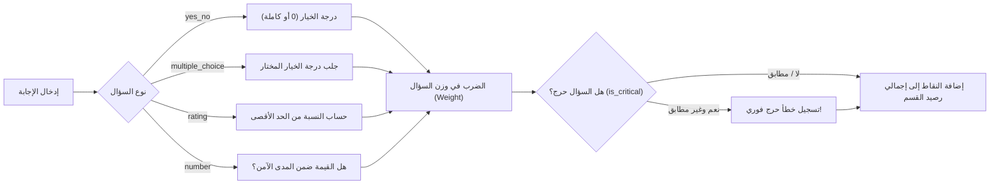
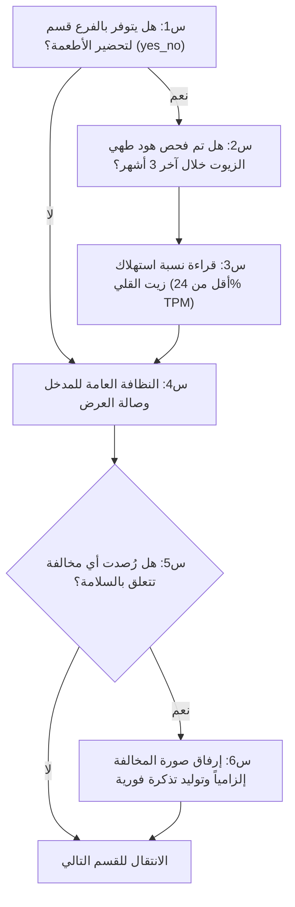

# الاستبيانات ونماذج الأسئلة

يتولى محرك الاستبيانات إدارة جمع البيانات الميدانية، ويدعم 6 أنواع مختلفة من الإدخالات مع أوزان ترجيحية وشروط تشعب ذكية.

---

## 1. أنواع الأسئلة المدعومة

| نوع السؤال | اسم الحقل | الاستخدام الشائع | آلية احتساب الدرجة |
| :--- | :--- | :--- | :--- |
| `yes_no` | مطابق / غير مطابق | فحص الاشتراطات الثنائية (مثل: *"هل طفاية الحريق صالحة؟"*) | الدرجة كاملة أو صفر |
| `multiple_choice` | خيارات متعددة | تقييم تدرج الجودة (مثل: *"مستوى النظافة: سيئ، متوسط، ممتاز"*) | درجة مخصصة لكل خيار |
| `rating` | مقياس التقييم | تقييم نسبي (من 1 إلى 5 نجوم أو من 1 إلى 10) | نسبة مئوية متناسبة مع التقييم |
| `number` | قيمة رقمية | قراءات الأجهزة، درجات الحرارة، أعداد العاملين | التحقق من الوقوع ضمن النطاق المسموح |
| `text` | نص وصفي | ملاحظات المفتش الحرة وتفاصيل الشرح | وصفي (وزن 0) |
| `date` | منتقي التاريخ | تواريخ انتهاء الرخص والشهادات الصحية | مقارنة مع تاريخ اليوم |

---

## 2. مسار احتساب درجات السؤال

---

## 3. الشروط التشعبية والاعتماديات الديناميكية

تتيح الشروط إظهار أو إخفاء أسئلة لاحقة تلقائياً بناءً على إجابات سابقة:

---

## 4. الأسئلة الحرجة (`is_critical`)

عند تفعيل علامة `is_critical: true` على أي سؤال:
- يؤدي تسجيل عدم المطابقة فيه إلى **تنبيه عاجل وفوري** لمدير الشركة والفرع.
- يتم فتح تذكرة تصحيحية ذات أولوية قصوى بمهلة معالجة لا تتجاوز **24 ساعة**.
- يرفع عداد `critical_errors` للزيارة، مما يؤثر مباشرة على التصنيف النهائي للفرع.
