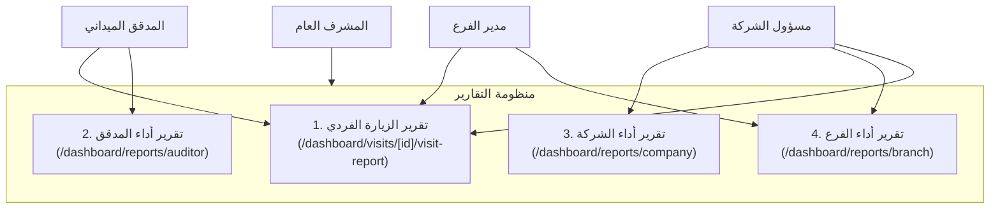
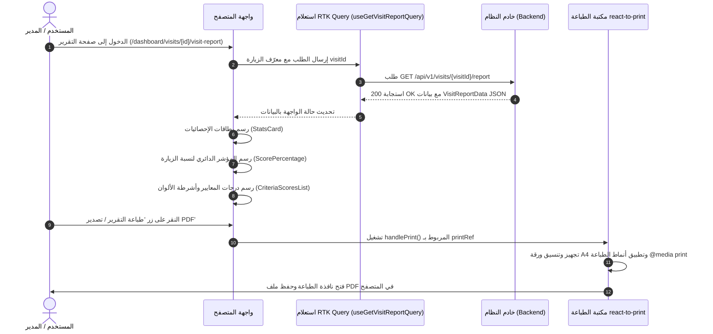

# التقارير ولوحات التحليلات

توفر منصة استقرار منظومة تقارير متكاملة تدعم كافة المستويات الإدارية من المفتش الميداني إلى الإدارة العليا.

---

## 1. أنواع التقارير الأربعة في المنصة

---

## 2. مواصفات ومؤشرات كل تقرير

| نوع التقرير | الفئة المستفيدة | المؤشرات والمكونات الرئيسية |
| :--- | :--- | :--- |
| **تقرير الزيارة (Visit Report)** | المفتش، مدير الفرع، مسؤول الشركة | • بطاقات الملخص التنفيذي: إجمالي الأسئلة، الصحيحة، الخاطئة، والأخطاء الحرجة. • مؤشر النسبة الدائري (`ScorePercentage`). • درجات أقسام المعايير مع أشرطة التقدم (`CriteriaScoresList`). • معرض صور الأدلة والمخالفات. • دعم التصدير والطباعة الرسمية عبر `react-to-print`. |
| **تقرير المدقق (Auditor Report)** | المفتش ورؤساء فرق التدقيق | • إجمالي الزيارات المكتملة مقابل المجدولة. • وتيرة الزيارات الشهرية ومتوسط الدرجات (`visits_by_month`). • متوسط مؤشر التقييم الممنوح من المدقق. • سجل التصحيحات المعتمدة مؤخراً. |
| **تقرير الشركة (Company Report)** | إدارة الجودة والمدير التنفيذي | • المؤشر التراكمي لامتثال الشركة ككل. • جدول ترتيب الفروع (الأعلى امتثالاً والأكثر خطورة). • تحليل المخالفات المتكررة بين الفروع. • إحصائيات الفروع النشطة والاشتراكات. |
| **تقرير الفرع (Branch Report)** | مدير الفرع ومسؤول التشغيل | • منحنى تغير درجات الفرع عبر الزيارات المتعاقبة. • المعايير المتكررة في عدم المطابقة. • حالة التذاكر التصحيحية المفتوحة والمغلقة. |

---

## 3. مسار توليد وطباعة التقارير

