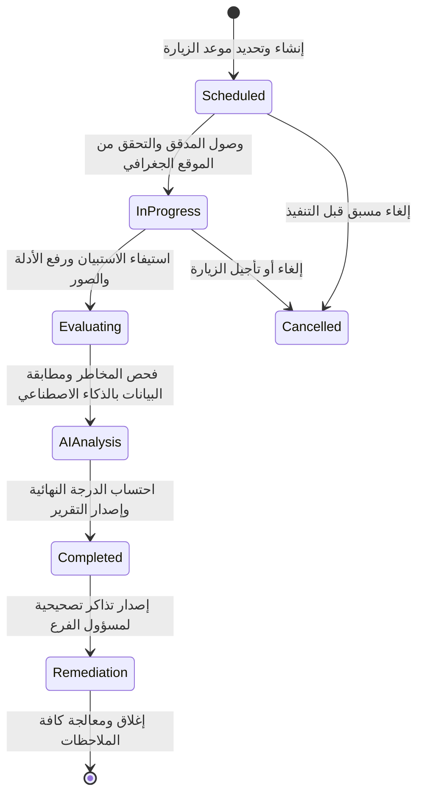
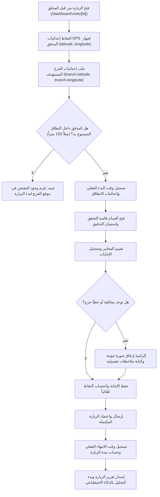

# إدارة وعمليات الزيارات الميدانية

تمثل الزيارات الميدانية المحور التشغيلي الأساسي لمنصة استقرار، حيث يتولى المفتشون فحص الفروع، والتحقق من الاشتراطات والمعايير، وتوثيق المخالفات بالصور والأدلة، وحساب درجات الامتثال بدقة.

---

## 1. مخطط دورة حياة الزيارة (State Machine)

تنتقل كل زيارة ميدانية عبر مراحل تشغيلية واضحة بدءاً من الجدولة وحتى معالجة الملاحظات:

---

## 2. التحقق من النطاق الجغرافي ومسار التنفيذ

لضمان الوجود الفعلي للمفتش داخل المنشأة، يجري النظام مطابقة فورية بين إحداثيات جهاز المفتش وإحداثيات الفرع قبل فتح نموذج التفتيش:

---

## 3. حقول وبيانات نموذج الزيارة (`Visit`)

| الحقل | النوع | الوصف الفني |
| :--- | :--- | :--- |
| `id` | `number` | المعرّف الرقمي الفريد للزيارة. |
| `company_id` | `number` | معرّف الشركة التابع لها الفرع. |
| `branch_id` | `number` | معرّف الفرع المستهدف بالتفتيش. |
| `auditor_id` | `number` | معرّف المدقق أو المفتش المكلف بالزيارة. |
| `checklist_id` | `number` | معرّف نموذج قائمة التحقق المعتمد للزيارة. |
| `scheduled_date` | `string` | التاريخ المجدول للزيارة (`YYYY-MM-DD`). |
| `scheduled_time` | `string` | الوقت المجدول لبدء الزيارة (`HH:mm`). |
| `actual_start_time` | `string?` | التوقيت الفعلي الدقيق لبدء التفتيش في الموقع. |
| `actual_end_time` | `string?` | التوقيت الفعلي الدقيق لإنهاء وإرسال التفتيش. |
| `status` | `string` | حالة الزيارة (`scheduled`، `in_progress`، `completed`، `cancelled`). |
| `total_score` | `number?` | إجمالي الدرجات المحققة من قبل الفرع. |
| `max_possible_score`| `number?` | الحد الأقصى الممكن من النقاط للأسئلة المطبقة. |
| `percentage` | `number?` | النسبة المئوية للتقييم: `(total_score / max_possible_score) * 100`. |
| `category` | `string?` | التصنيف النوعي للزيارة (مثل `ممتاز`، `جيد`، `غير مطابق`). |
| `start_latitude` | `string?` | خط عرض GPS للمدقق لحظة بدء الاستبيان. |
| `start_longitude` | `string?` | خط طول GPS للمدقق لحظة بدء الاستبيان. |
