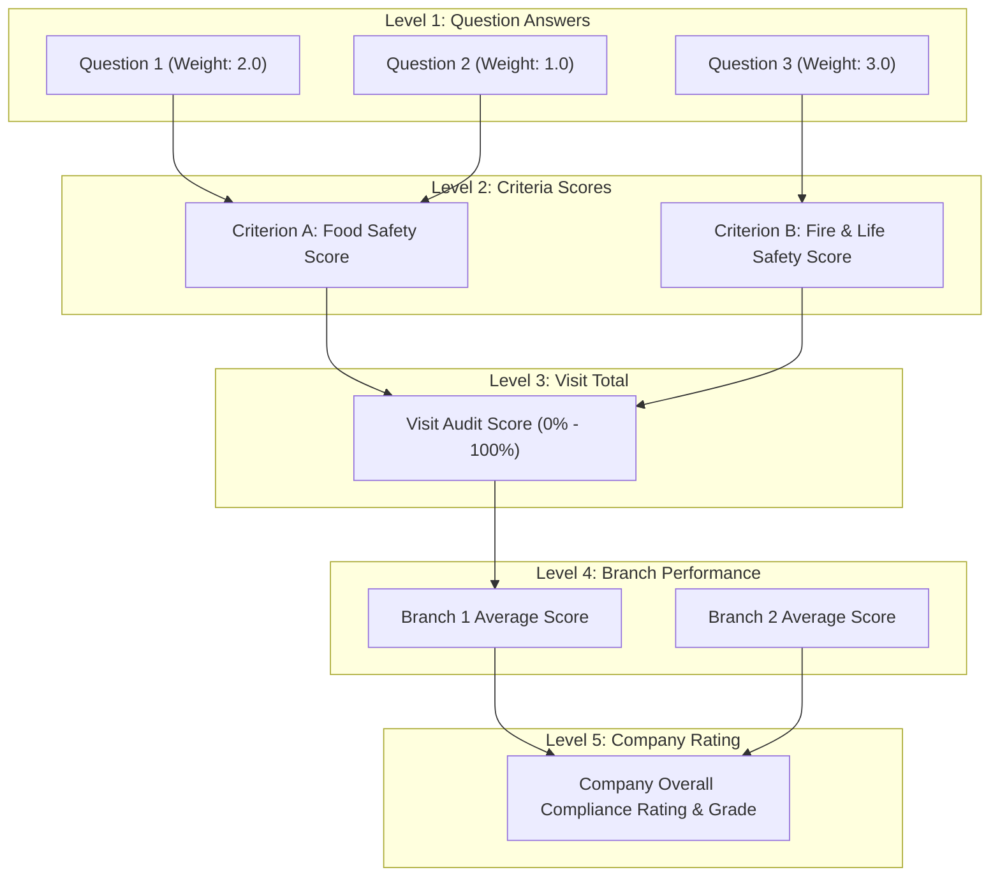
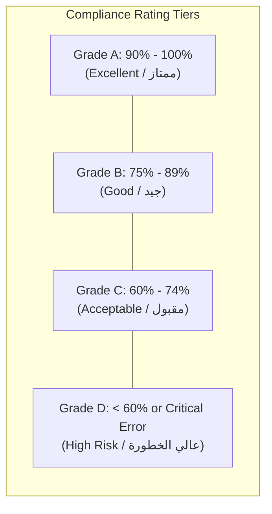
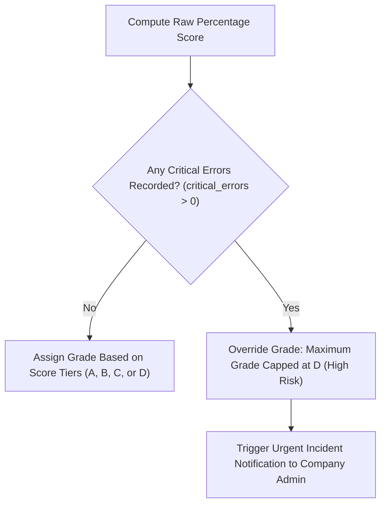

# Company Rating & Compliance Scoring

The Istqrar rating system converts hundreds of individual inspection observations into clear, actionable executive ratings and compliance grades.

---

## 1. Compliance Score Rollup Hierarchy

The scoring engine aggregates data hierarchically from individual questions up to the corporate enterprise rating:



---

## 2. Mathematical Formulas

### Criterion Score Percentage

Each criterion aggregates all associated questions:

```
Criterion Score % = [Σ (Earned Score_i × Weight_i) ÷ Σ (Max Score_i × Weight_i)] × 100
```

Where:
- `Earned Score_i` is points achieved on question *i*.
- `Weight_i` is the relative importance multiplier of question *i*.

### Overall Visit Score

```
Visit Score % = (Σ Earned Criterion Points ÷ Σ Possible Criterion Points) × 100
```

### Company Portfolio Rating

The overall company rating aggregates performance across all active branches over a selected time interval:

```
Company Overall Score = (Σ Branch Scores) ÷ (Total Audited Branches M)
```

Where $M$ is the total number of branches with completed audits.

---

## 3. Rating Tiers & Grade Scale

Istqrar applies standardized classification tiers to categorize audit outcomes:



| Grade | Score Range | Color Code | Action Required |
| :--- | :--- | :--- | :--- |
| **Grade A** | 90.0% – 100% | Green (`#16a34a`) | Optimal compliance. Maintain standard quarterly audit schedule. |
| **Grade B** | 75.0% – 89.9% | Blue (`#2563eb`) | Minor observations. Resolve non-critical tickets within 14 days. |
| **Grade C** | 60.0% – 74.9% | Amber (`#d97706`) | Moderate compliance risk. Mandatory follow-up audit within 30 days. |
| **Grade D** | Below 60% OR $\ge 1$ Critical Error | Red (`#dc2626`) | High risk. Immediate executive escalation; re-inspection required within 48 hours. |

---

## 4. The Critical Error Override Rule

A core safety feature of the Istqrar rating engine is the **Critical Error Override**:



> **Rule**: Even if a facility scores 94% on general cleanliness and documentation, if a critical life safety item fails (e.g. fire exit locked from inside or spoiled food in active service), the visit is automatically overridden with a **Critical Risk** status.
