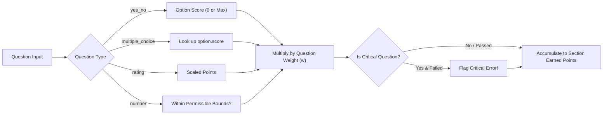
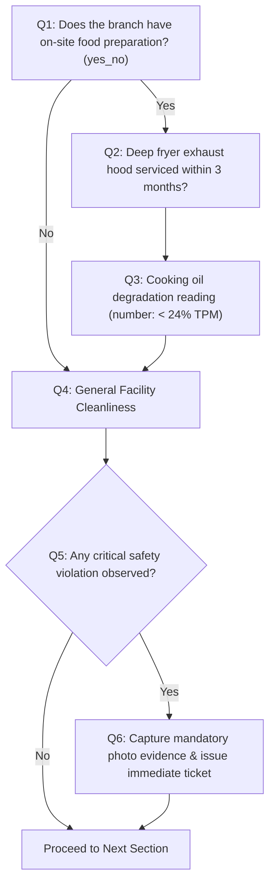

# Questions & Questionnaires Engine

The questionnaire engine powers audit data collection. It supports multiple input types, weight multipliers, mandatory attachments, and conditional branching logic.

---

## 1. Supported Question Types

The `Question` schema supports 6 distinct input formats tailored to diverse inspection procedures:

| Type Code | Input Name | Typical Use Case | Scoring Mechanism |
| :--- | :--- | :--- | :--- |
| `yes_no` | Binary Boolean | Direct compliance checks (e.g. *"Is the fire extinguisher valid?"*) | 100% or 0% points |
| `multiple_choice` | Single / Multi Select | Standardized graded answers (e.g. *"Cleanliness Level: Poor, Fair, Good"*) | Score defined per option |
| `rating` | Numeric Rating Scale | Qualitative assessment (1 to 5 stars / 1 to 10 points) | Scaled proportional score |
| `number` | Quantitative Metric | Sensor readings, temperatures, storage counts, employee counts | Range-based validation |
| `text` | Open-ended Field | Free-form auditor observations, inspector summaries | Informational (0 weight) |
| `date` | Date Picker | Document expiration dates, permit renewals, calibration dates | Threshold comparison |

---

## 2. Question Evaluation & Scoring Flow



---

## 3. Question Data Structure

The `Question` interface defines the rules governing each questionnaire prompt:

```typescript
export interface Question {
  id: number;
  checklist_id: number;
  criteria_id: number;
  question_text: string;
  description?: string | null;
  help_text?: string | null;
  type: "yes_no" | "multiple_choice" | "rating" | "text" | "number" | "date";
  options?: QuestionOption[];
  weight: number;             // Priority multiplier (e.g. 1.0, 2.5, 5.0)
  max_score: number;          // Maximum raw points achievable
  passing_score: number;      // Threshold for passing
  is_required: boolean;       // Must be answered to finish the visit
  is_critical: boolean;       // If failed, flags a critical violation
  has_attachment: boolean;    // Requires photo proof when non-compliant
  attachment_instructions?: string | null;
  sort_order: number;
}
```

---

## 4. Conditional Branching & Dynamic Dependencies

Questions can be conditionally rendered based on answers to prior questions. This prevents questionnaire bloat by only showing relevant checks.



---

## 5. Critical Questions (`is_critical`)

When `is_critical` is set to `true`:
- A negative response immediately triggers an **instant critical incident alert**.
- It generates a mandatory ticket with **Urgent/Critical SLA (24 hours)**.
- It increments the visit's `critical_errors` counter, which appears prominently in the executive scorecard.
