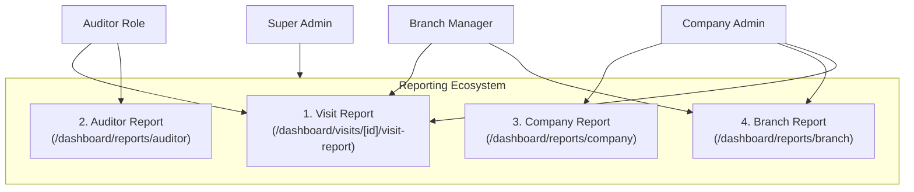
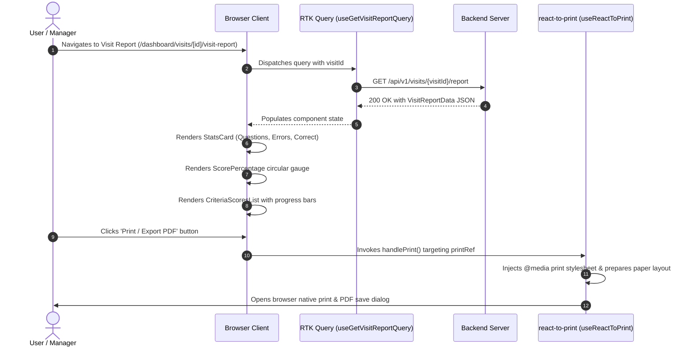

# Reports & Analytics System

Istqrar features a multi-tiered reporting architecture providing tailored views for field auditors, branch managers, corporate executives, and regulatory supervisors.

---

## 1. The Four Platform Report Types

---

## 2. Report Specifications & Metrics

| Report Type | Primary Target Audience | Core Metrics & Components Included |
| :--- | :--- | :--- |
| **Visit Report** | Auditor, Branch Manager, Admin | • Executive Scorecard (`StatsCardProps`): Total questions, Correct, Incorrect, Critical Errors. • Circular Score Gauge (`ScorePercentage`). • Criteria breakdown bars (`CriteriaScoresList`). • Photographic evidence attachments. • Printable single-page or multi-page PDF via `react-to-print`. |
| **Auditor Report** | Field Auditor, Inspection Lead | • Total completed vs scheduled visits. • Monthly audit volume trend (`visits_by_month`). • Average score index awarded by this auditor. • Recent verified corrections log. • Upcoming inspection calendar. |
| **Company Report** | Corporate Executive, Quality Director | • Aggregated corporate compliance index. • Branch performance ranking table (Top vs Low performers). • Cross-branch violation heatmaps. • Active vs expired branch subscription statuses. |
| **Branch Report** | Branch Manager, Operations Lead | • Longitudinal score trend over consecutive quarters. • Recurring failure criteria. • Open vs resolved corrective action tickets. • Inspector notes and re-inspection logs. |

---

## 3. Report Generation & Print Pipeline

The following sequence details how visit audit data is fetched, rendered into interactive cards, and formatted for paper or digital PDF export:

---

## 4. Key UI Components in Reporting

- **`StatsCard`** (`src/components/dashboard/stats-card/`): Standardized summary widgets featuring Lucide icons, status pill badges, and numeric counts.
- **`ScorePercentage`** (`src/components/dashboard/visits/score-percentage.tsx`): Radial progress meter displaying percentage, categorical grade, and color-coded status.
- **`CriteriaScoresList`** (`src/components/dashboard/visits/criteria-scores-list.tsx`): Accordion of compliance criteria showing earned vs possible points with color bars.
- **`CompanyReportsPrint`** (`src/components/dashboard/reports/print-models/`): Dedicated high-resolution layout optimized for A4 page breaks, letterheads, and executive summaries.
