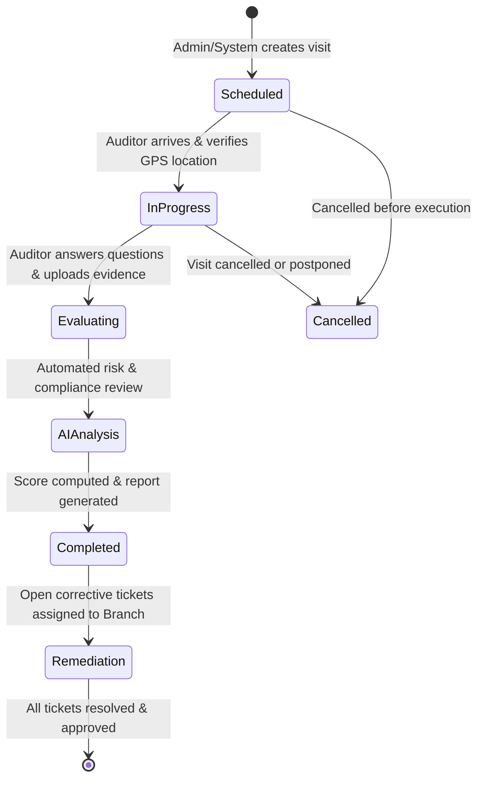
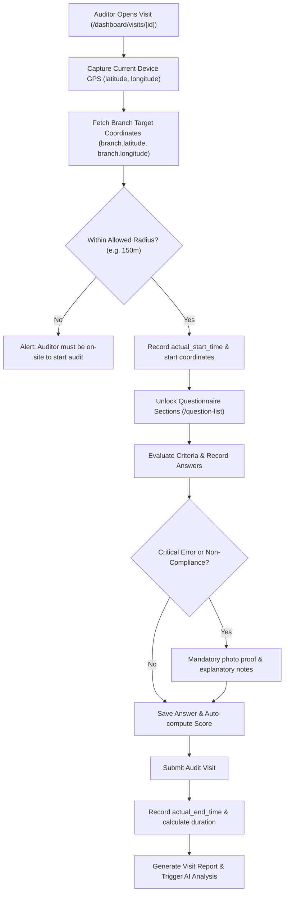

# Visits & Audit Operations

Visits represent the operational core of the Istqrar platform. Auditors conduct on-site or remote inspections, verify physical branch conditions against checklists, capture photo evidence, and compute objective compliance scores.

---

## 1. Visit Lifecycle State Machine

Each visit transitions through distinct operational phases from initial scheduling to post-audit remediation.

---

## 2. Geolocation & Audit Execution Flow

To guarantee physical presence at the audited branch, the system performs a geographic distance calculation before unlocking the questionnaire.

---

## 3. Data Model & Field Reference

The visit object (`Visit`) contains audit metadata, timing metrics, location data, and aggregated scoring results:

| Field | Type | Description |
| :--- | :--- | :--- |
| `id` | `number` | Unique visit identifier. |
| `company_id` | `number` | Foreign key referencing the parent company. |
| `branch_id` | `number` | Target branch where the audit takes place. |
| `auditor_id` | `number` | Licensed inspector assigned to the audit. |
| `checklist_id` | `number` | Assigned checklist template. |
| `scheduled_date` | `string` | Planned inspection date (`YYYY-MM-DD`). |
| `scheduled_time` | `string` | Planned inspection start time (`HH:mm`). |
| `actual_start_time` | `string?` | Exact timestamp when auditor initiated the visit on-site. |
| `actual_end_time` | `string?` | Exact timestamp when the visit was submitted. |
| `status` | `string` | `scheduled`, `in_progress`, `completed`, `cancelled`. |
| `total_score` | `number?` | Total points earned by the branch. |
| `max_possible_score`| `number?` | Maximum points achievable for the active questions. |
| `percentage` | `number?` | Final score percentage: `(total_score / max_possible_score) * 100`. |
| `category` | `string?` | Performance classification tier (e.g. `excellent`, `good`, `poor`). |
| `start_latitude` | `string?` | Auditor GPS latitude upon beginning the questionnaire. |
| `start_longitude` | `string?` | Auditor GPS longitude upon beginning the questionnaire. |

---

## 4. AI-Powered Visit Analysis

Once a visit is completed, the system feeds the questionnaire results and auditor notes into the AI Analysis pipeline (`/dashboard/visits/[visitId]/ai-analysis`):

1. **Anomaly & Pattern Detection**: Correlates answers across different sections to identify contradictions (e.g., cold room reported functional, but dairy products recorded above permissible temperature).
2. **Severity Classification**: Ranks issues into Low, Medium, High, and Critical.
3. **Corrective Recommendations**: Formulates action plans tailored to the specific Saudi regulatory standards.
